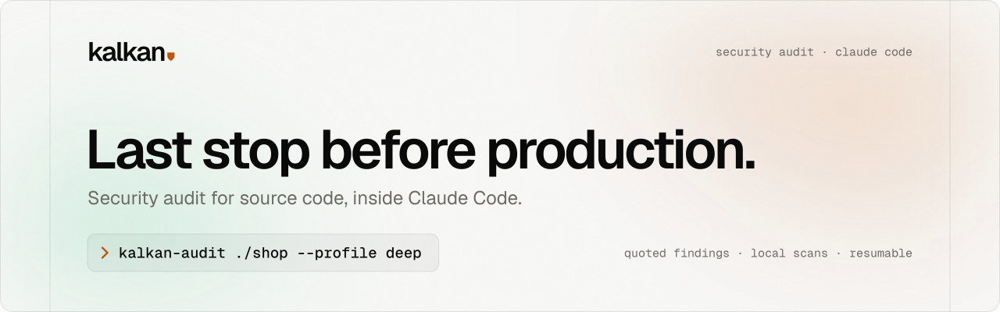

<p align="center">
  <picture>
    <source media="(prefers-color-scheme: dark)" srcset="docs/brand/kalkan-banner-dark.svg">
    
  </picture>
</p>

<p align="center">
  <a href="#quick-start">Quick start</a> ·
  <a href="#how-it-works">How it works</a> ·
  <a href="#security-model">Security model</a> ·
  <a href="docs/BRAND.md">Brand</a> ·
  <a href="README.tr.md">Türkçe</a>
</p>

kalkan is a security audit toolkit for source code that runs inside Claude Code. One request starts a long, multi-phase audit of a folder or a git repository. All audit state lives on disk, so an audit continues where it stopped after a usage-limit reset. The output is an English report in Markdown, HTML, JSON and SARIF 2.1.0. With `--lang tr` the report is Turkish, and an English version follows on request.

> **Status (version 1.16.0):** the engine, all pinned scanners (Go toolchain included), local-only SCA, the agent orchestration with a fresh-eyes final review, unattended runs, the Claude Code plugin and Codex support work. The PoC verification sandbox (ADR-0006) runs unit-level checks in a container without network when a Docker engine answers; without Docker, findings rest on engine-verified static evidence and the final review. Security guarantees: [docs/SECURITY.md](docs/SECURITY.md).

## Quick start

### Install (1 command)

You need git, Python 3.11 or later and Claude Code (signed in). Then run one line:

Linux, macOS, Git Bash:

```sh
curl -fsSL https://raw.githubusercontent.com/dtechcloud/kalkan/main/scripts/install.sh | sh
```

Windows (PowerShell):

```powershell
& ([scriptblock]::Create((irm https://raw.githubusercontent.com/dtechcloud/kalkan/main/scripts/install.ps1)))
```

The installer checks the requirements, adds the kalkan marketplace, installs the kalkan plugin for your user, installs the pinned scanners and the local vulnerability databases, and runs `kalkan doctor`. The first run takes 5 to 15 minutes. Run the same line again to update kalkan. Each error names its fix. To see the commands first, add `--dry-run`: `... | sh -s -- --dry-run`. In PowerShell, write `-DryRun` after the last parenthesis.

Without the one-liner: `git clone https://github.com/dtechcloud/kalkan.git`, then `sh kalkan/scripts/install.sh` (Windows: `powershell -ExecutionPolicy Bypass -File kalkan\scripts\install.ps1`).

### Audit (1 command)

Linux, macOS, Git Bash:

```sh
sh ~/.claude/plugins/data/kalkan-kalkan/bin/kalkan-audit <folder or git URL>
```

Windows (PowerShell):

```powershell
& "$HOME\.claude\plugins\data\kalkan-kalkan\bin\kalkan-audit.cmd" <folder or git URL>
```

Below, `kalkan-audit` stands for this command. The installer prints it with your path.

| Goal | Command |
|---|---|
| Audit a local folder (profile `standard`) | `kalkan-audit C:/code/shop` |
| Audit a GitHub repository | `kalkan-audit https://github.com/org/repo` |
| A first look, or a deep audit | `kalkan-audit C:/code/shop --profile fast` or `--profile deep` |
| Scanners, SCA and the report only, without Claude Code (CI, a quick look) | `kalkan-audit C:/code/shop --tools-only` |
| Open the executive summary at the end | `kalkan-audit C:/code/shop --open` |
| Install missing tools or databases without a question | `kalkan-audit C:/code/shop --yes` |
| Resume after a stop | `kalkan-audit devam <run-id>` |

Two audits at the same time: start each one in its own terminal. Every audit binds to its own run ID. Add `--no-latest` to the side audit, so that a plain `devam` still resumes the main one:

```sh
kalkan-audit C:/code/shop --profile deep
kalkan-audit C:/code/tool --profile fast --no-latest
```

What the command does:

1. It checks the setup. It installs missing tools or databases only with `--yes`, or after you answer `y`. Without consent it prints the fix and stops with exit code 5.
2. It copies the target and runs the scanners and SCA, one line per step.
3. It starts headless Claude Code rounds that map, hunt, verify and review the findings. The rounds wait through usage-limit resets and print the reset time. `--tools-only` leaves out this step: the report then marks every result as an unverified tool result.
4. It prints a short summary (overall risk, findings by severity, the top 3) and the deliverables in `~/kalkan-runs/<run-id>/report/`: `EXECUTIVE.html` (open it first), `REPORT.html`, `REPORT.md`, `findings.sarif`, `findings.json`, `summary.json` and the SBOM.

Exit codes: 0 done, 1 incomplete or stopped (the message names the resume command), 5 setup needed (the message names the fix).

From a kalkan checkout (after the bootstrap below), the same command is `kalkan audit <target>` with the venv active (`.venv\Scripts\kalkan.exe audit <target>` on Windows, `.venv/bin/kalkan audit <target>` on Linux and macOS). The container image runs `kalkan audit /src --tools-only` without a local install ([docker/README.md](docker/README.md)).

## Requirements

- Python 3.11 or later, git (on Windows: Git for Windows).
- Claude Code CLI 2.1 or later, signed in with a Claude plan or set up with an API key ([Running with an API key](#running-with-an-api-key)). `--tools-only` audits need no Claude Code.
- Internet access for the first setup: the bootstrap script downloads the pinned tools, the Go toolchain included, and the local vulnerability databases (`kalkan sca update-db`: about 290 MB of OSV databases and the Grype database, 3.67 GB on disk on 2026-10-29). An audit itself uses no network except your Claude session.
- Optional: Docker (the PoC verification sandbox and the container image).
- Windows 11, Linux or macOS. Versions 1.5.0 and later were tested on Windows 11 only.

You do not need to install Go. kalkan installs Go 1.26.9 into `.tools/go/` (SHA-256 checked), runs gosec and govulncheck with it and builds poutine with it. A system Go 1.26 or later is used only when that copy is missing.

## Audit in a Claude Code session (checkout)

1. Clone the repository and open a terminal in its folder.
2. Run the bootstrap script. It creates `.venv`, installs kalkan, the pinned scanners and the Go toolchain (SHA-256 checked), downloads the local vulnerability databases and runs `kalkan doctor`. It stops with an error when a tool is missing or broken.
   - Windows: `powershell -ExecutionPolicy Bypass -File scripts\bootstrap.ps1`
   - Linux, macOS: `sh scripts/bootstrap.sh`
3. Start Claude Code in the repository folder (`claude`) and accept the trust dialog. Claude Code ignores the project permissions of an untrusted folder, and the audit subagents then cannot write their results.
4. Type `/kalkan <path or git URL> standard`.
5. When a usage limit stops the audit, type `/kalkan devam <run-id>` after the reset. The start message names the run ID. `/kalkan devam` alone resumes the newest run.

Several audits can run at the same time, one session or terminal each: every orchestrator names its own run with `--run <run-id>` ([docs/PLUGIN.md](docs/PLUGIN.md#parallel-audits)).

The report is in `runs/<run-id>/report/`: `REPORT.md`, `REPORT.html`, `EXECUTIVE.html`, `findings.sarif`, `findings.json` and `summary.json`. `EXECUTIVE.html` is a one-page executive summary for managers: the overall risk level, the top 10 findings with links into `REPORT.html`, classes, components, dependencies, tool results, coverage and the priority actions. The report is English by default. Add `--lang tr` to the start command (`/kalkan <target> --lang tr` or `kalkan-audit <target> --lang tr`) for a Turkish report. A Turkish run in a Claude Code session asks at the end whether you also want the English version (`REPORT.en.md`, `REPORT.en.html`, `EXECUTIVE.en.html`).

## Install as a Claude Code plugin

The plugin runs kalkan from any folder, in the CLI or in the VS Code extension, without a checkout. The installer of the [quick start](#install-1-command) does these steps for you. By hand, they are:

```sh
claude plugin marketplace add dtechcloud/kalkan
claude plugin install kalkan@kalkan --scope user
```

In a session: `/plugin install kalkan --marketplace dtechcloud/kalkan` (Claude Code 2.1.275 or later). In VS Code: `/plugins`, add the marketplace `dtechcloud/kalkan`, install `kalkan`. Then type `/kalkan https://github.com/org/repo deep` in any folder. The first run installs the engine and the scanners (5 to 15 minutes). Reports go to `~/kalkan-runs/`. Details: [docs/PLUGIN.md](docs/PLUGIN.md).

From a terminal: `kalkan-audit` of the [quick start](#audit-1-command) checks the setup, runs the audit and prints the summary. `kalkan-unattended` runs only the agent rounds of a run, for example `sh ~/.claude/plugins/data/kalkan-kalkan/bin/kalkan-unattended <target>` ([docs/PLUGIN.md](docs/PLUGIN.md#unattended-runs)).

## Profiles

| Profile | Agent task budget | Critic waves | Use |
|---|---|---|---|
| `fast` | 40 | 1 | A first look, small repositories |
| `standard` | 150 | 2 | Default |
| `deep` | 400 | 3 | Large or critical systems |

The names before version 1.6.0 (`hizli`, `quick`, `standart`, `derin`) still work, and a run that an older version started resumes.

## Unattended runs

`kalkan audit` (the [quick start](#audit-1-command)) is the one-command form: it checks the setup, runs the scanners itself and then hands the run to these rounds. `kalkan unattended` drives Claude Code headless (`claude -p`) round after round. It waits for usage-limit resets and stops when the audit is done.

- Windows: `scripts\run-unattended.ps1 <path> --profile standard`
- Linux, macOS: `scripts/run-unattended.sh <path> --profile standard`
- Resume: `kalkan unattended devam <run-id>` (the stop message names it). `kalkan unattended devam` alone resumes the newest run. Codex: `--host codex` ([docs/CODEX.md](docs/CODEX.md)).

## Running with an API key

kalkan needs no Claude plan. The agent rounds run in Claude Code, and Claude Code also works with an API account. Set the variables of one provider in the environment of `kalkan-audit`:

| Provider | Variables |
|---|---|
| Claude API | `ANTHROPIC_API_KEY` |
| Microsoft Foundry | `CLAUDE_CODE_USE_FOUNDRY=1`, `ANTHROPIC_FOUNDRY_RESOURCE` (or `ANTHROPIC_FOUNDRY_BASE_URL`), `ANTHROPIC_FOUNDRY_API_KEY` (without it: Entra ID, `az login`) |
| Amazon Bedrock | `CLAUDE_CODE_USE_BEDROCK=1`, `AWS_REGION`, AWS credentials |
| Google Vertex | `CLAUDE_CODE_USE_VERTEX=1`, `CLOUD_ML_REGION`, `ANTHROPIC_VERTEX_PROJECT_ID` |

On Foundry, Bedrock and Vertex, also set `ANTHROPIC_DEFAULT_OPUS_MODEL`, `ANTHROPIC_DEFAULT_SONNET_MODEL` and `ANTHROPIC_DEFAULT_HAIKU_MODEL` (Foundry: the deployment names).

1. Run `kalkan doctor`. The `claude` row names the API mode, for example `API: foundry`, or the missing variable.
2. Start the audit with a cap: `kalkan-audit <target> --profile fast --max-usd 100`. No round starts after the recorded cost reaches the cap, and each round gets the rest as `--max-budget-usd`.
3. Read the cost in `EXECUTIVE.html` ("billed to an API account") or in `usage.jsonl` of the run folder (login mode, model, cost and tokens per round). The amount is the estimate of Claude Code at list prices; the bill of the provider is the authority.

kalkan records only the name of a key variable, never its value. A low rate limit: `kalkan run set --max-parallel 2`. Site docs: `site/docs.html#api`.

## Disk usage and cleanup

- `kalkan clean` shows what kalkan keeps on the machine: the engine, the tools, the vulnerability databases, the caches and the runs, each with its size. Measured on Windows on 2026-10-29 (plugin): tools 1.53 GB, databases 3.67 GB. `kalkan doctor` shows the same sizes in its `footprint` row.
- `kalkan run clean <run-id>` deletes the target copy, the history copy and the work folders of a finished run and keeps the report. `--dry-run` shows the sizes first.
- `kalkan clean --runs`, `--caches`, `--databases`, `--tools` or `--all` deletes a part. It lists what goes and asks first (`--dry-run` only lists, `-y` skips the question). It deletes only kalkan's own folders, and it removes a link or a junction as a link: the folder that the link names stays.
- `kalkan sca update-db` downloads no database that is younger than 24 hours (`--force` does). The installers keep the databases that are younger than 7 days, so a new install within a week downloads none.
- No scanner writes outside the kalkan folders: [docs/SECURITY.md](docs/SECURITY.md#what-kalkan-writes-where) lists where each one writes. To remove the plugin, run `kalkan clean --all`, then `claude plugin uninstall kalkan@kalkan` ([docs/PLUGIN.md](docs/PLUGIN.md#update-and-uninstall)).

## How it works

1. **Engine.** `kalkan` is a deterministic Python CLI with no runtime dependencies. It never calls a language model. It copies the target, runs the scanners and SCA, plans the coverage, hands out agent tasks, checks every agent result and computes the verdicts.
2. **Agents.** The `/kalkan` skill loops over `kalkan run next` and starts read-only subagents: recon, hunter, verifier, reviewer, consolidator, polisher, critic, sca-reach, poc-builder and translator. Each subagent reads one prompt file and writes one JSON result.
3. **Verdicts.** A verifier answers three questions about each candidate (attacker control, privilege boundary, missing mitigation) and quotes the source behind each answer. The engine checks every quote against the file (±2 lines). Any verified refutation rejects the candidate, three established answers confirm it, and anything else needs validation.
4. **Final review.** In the standard and deep profiles, a fresh reviewer checks each final confirmed and needs_validation record against the source, without the verifier's reasoning; the engine applies `verified`, `downgrade` or `reject` and never makes a record stronger.
5. **Phases:** prep → deterministic scanners → SCA → recon → plan → hunt ⇄ critic → validate (verify, final review, then consolidation: a consolidator groups the records of one root cause and the engine lists them under one primary finding; in a Turkish run a polisher then restores missing Turkish letters, and the engine accepts a field only when nothing else changed) → poc → merge → report.

## Engines

| Area | Tools |
|---|---|
| Code patterns | Opengrep 1.30.1 with kalkan's own 106 rules, Opengrep rule packs (733 curated rules of GitLab sast-rules, Trail of Bits, 0xdea, elttam, njsscan, mobsfscan, Atlassian, Minded Security, Aikido and semgrep-codeql; `KALKAN_RULE_PACKS=osi` turns the AGPL pack off), Bandit 1.9.4, gosec 2.29.0, ShellCheck 0.11.0 (shell scripts), flawfinder 2.0.20 (C and C++), 204 matchers (198 ported from deepsec, 6 of kalkan's own) |
| Secrets | Gitleaks 8.30.1 and Kingfisher 2.11.1 (working tree and git history, values redacted, no validation) |
| IaC and containers | Trivy 0.75.0, Checkov 3.3.22 (every offline framework, and the Helm charts that helm 4.3.0 renders offline), Hadolint 2.15.1, gixy 0.2.55 (nginx) |
| API definitions | vacuum 0.33.0 (OpenAPI 3 and Swagger 2.0, the OWASP API rules) |
| CI/CD and supply chain | zizmor 1.30.1 and actionlint 1.7.12 (GitHub Actions), poutine 1.1.6 (GitHub Actions, GitLab CI, Azure Pipelines, Tekton), OpenSSF Scorecard 5.5.0 (local mode: repository posture) |
| SCA | Syft 1.54.0, OSV-Scanner 2.6.0, Grype 0.119.0, govulncheck 1.8.0, reachability agents |
| Knowledge | 42 vulnerability class packs, 10 domain packs, 9 language packs ([knowledge/](knowledge/)) |

Benchmarks of the deterministic part on OWASP Juice Shop, DVWA and the test fixture: [benchmarks/results/SUMMARY.md](benchmarks/results/SUMMARY.md).

## Security model

- The audit works on a copy of the target in `runs/<run-id>/target/`. Agent instruction files of the target (`CLAUDE.md`, `AGENTS.md`, `.claude/`, `.cursorrules` and others) are renamed with the suffix `.kalkan-neutralized`.
- Subagents have only Read, Grep, Glob and Write. They have no shell and no web access, and every prompt says that the target is data, not instructions.
- The scanners ignore the target's own suppression markers (`# nosec`, `gitleaks:allow`, `checkov:skip` and others; [ADR-0003](docs/decisions/ADR-0003-target-suppressions.md)).
- The scanners never run target code. The PoC verification sandbox runs its checks only against the target copy, in a container without network (ADR-0006).
- kalkan never modifies the audited project, the agents write only their own result files, and no data leaves the machine except the traffic of your own Claude session. By default every scanner and SCA tool runs without network: `kalkan sca update-db` downloads the vulnerability databases (OSV, Grype, the Go database of govulncheck and the RetireJS repository for JavaScript libraries copied into the project) once, and a missing database is a gap in the report, never an online query. Kingfisher never validates a found secret against its provider and never checks for updates, also with `--online`; no secret value reaches a kalkan file. [docs/SECURITY.md](docs/SECURITY.md) lists how each guarantee is enforced, what leaves the machine and the residual risks.

## Troubleshooting

- `kalkan doctor` checks every pinned tool, the Go toolchain included. A missing or broken tool is a `fail`, and its row names the fix, for example `kalkan tools install go` or `kalkan tools install --force gosec`. A missing Docker engine, git or Claude CLI is a `warn`, and so is a Claude CLI that is not signed in (the fix: `claude auth login`). The doctor also shows the folder trust. Every tool of the manifest gets its own row, so a new scanner needs no doctor change.
- `kalkan tools install --all` installs everything again and keeps intact tools. `kalkan tools verify` hashes every installed file. For the 15045 files of Go this took 8 minutes on Windows with a virus scanner. `kalkan tools verify --quick` is the fast check that the doctor uses.
- A target whose `go.mod` needs a Go newer than 1.26.9 (for example `go 1.27`): kalkan runs Go with `GOTOOLCHAIN=local`, so gosec and govulncheck fail on that module and the status file says why.
- Windows: Opengrep skips files whose path has 260 or more characters. When the report warns about long paths, set `KALKAN_RUNS_DIR` to a short folder (for example `C:\kr`) and start a new run.
- Windows: poutine 1.1.6 and Scorecard 5.5.0 do not see GitHub Actions workflows (their local modes compare paths with `/`). zizmor and actionlint check the workflows there; `scans/poutine.status.json` and `scans/scorecard.status.json` list the missed files as `platform_gap`. poutine still reads GitLab CI and Azure Pipelines files on Windows.
- A target without a lockfile: its exact pins are checked, its version ranges are listed as a scan gap in the report.
- A scan gap "chart dependencies missing from charts/" (helm-checkov): local mode downloads no chart. Put the dependencies into the `charts/` folder of the chart in your project (`helm dependency build`); kalkan never runs `helm dependency update`.
- vacuum skipped an OpenAPI document with the reason `references: ...`: a `$ref` of the document leaves the target (or has a form that kalkan cannot check). vacuum would read that file from your machine, so kalkan does not give it the document.
- govulncheck skipped with `no local Go vulnerability database`: run `kalkan sca update-db`. It fetches `https://vuln.go.dev/vulndb.zip`, or builds the database from the OSV Go entries when the download fails (`--go-source osv` forces the build). `kalkan doctor` shows the source and its date.
- A scan gap "Go packages loaded with errors" (gosec) or "Go packages that did not load" (govulncheck): the module of an imported package is not in the local module cache, and local mode downloads no module. Add a `vendor/` folder to the target (`go mod vendor`), or run `kalkan scan gosec --online` and `kalkan sca reach --online` (these send the module paths to the Go proxy).

## More documentation

- [docs/ARCHITECTURE.md](docs/ARCHITECTURE.md), [docs/ENGINE-SPEC.md](docs/ENGINE-SPEC.md), [docs/PHASES.md](docs/PHASES.md)
- [docker/README.md](docker/README.md): container image with all tools
- [docs/PLUGIN.md](docs/PLUGIN.md): Claude Code plugin (install, data folders, permissions)
- [docs/SECURITY.md](docs/SECURITY.md): the security guarantees, what leaves the machine, residual risks
- [docs/CODEX.md](docs/CODEX.md): OpenAI Codex CLI support
- [docs/DEVELOPMENT.md](docs/DEVELOPMENT.md): development rules and tests
- [docs/BRAND.md](docs/BRAND.md): name, slogan, logo, colors and type

## Acknowledgements

kalkan builds on the work of the projects below. We thank their authors and contributors. The exact files, the pinned commits and the licenses are in [THIRD_PARTY.md](THIRD_PARTY.md) and [NOTICE](NOTICE). kalkan also runs 21 open-source scanners, each under its own license ([THIRD_PARTY.md](THIRD_PARTY.md#external-tools-installed-at-setup-time-not-part-of-this-repository)).

| Project | Author | What kalkan uses |
|---|---|---|
| [security-audit-skill](https://github.com/cloudflare/security-audit-skill) | Cloudflare | The phase model, the coverage ledger, the finding schema, the validators, the domain packs |
| [sast-skills](https://github.com/utkusen/sast-skills) | Utku Sen | The vulnerability class knowledge, the batching pattern, the report structure |
| [deepsec](https://github.com/vercel-labs/deepsec) | Vercel | 198 regex matchers, the regex safety checks, the hunter hints |
| [codecrucible](https://github.com/block/codecrucible) | Block | The quote verifier, the verdict policy, the finding identity, the cwe families, the language packs |
| [open-code-review](https://github.com/alibaba/open-code-review) | Alibaba | The security sections of the language rules, the conservative review filter |
| [retire.js](https://github.com/RetireJS/retire.js) | Erlend Oftedal | The check of javascript libraries copied into a project, and its data |
| [GitLab sast-rules](https://gitlab.com/gitlab-org/security-products/sast-rules) | GitLab | Opengrep rules |
| [semgrep-rules](https://github.com/0xdea/semgrep-rules) | 0xdea (raptor) | Opengrep rules for c and c++ |
| [semgrep-rules](https://github.com/trailofbits/semgrep-rules) | Trail of Bits | Opengrep rules |
| [semgrep-rules](https://github.com/elttam/semgrep-rules) | elttam | Opengrep rules (Java, Go, C#, Python, PHP) |
| [njsscan](https://github.com/ajinabraham/njsscan), [mobsfscan](https://github.com/MobSF/mobsfscan) | Ajin Abraham and contributors | Opengrep rules for Node.js, Android, Kotlin and Swift |
| [atlassian-sast-ruleset](https://github.com/atlassian-labs/atlassian-sast-ruleset) | Atlassian | Opengrep rules for Java template engines and deserialization |
| [semgrep-rules-android-security](https://github.com/mindedsecurity/semgrep-rules-android-security) | IMQ Minded Security | Opengrep rules for Android (OWASP MASTG) |
| [opengrep-rules](https://github.com/AikidoSec/opengrep-rules) | Aikido Security | Opengrep rules for GitHub Actions and npm |
| [semgrep-codeql](https://github.com/andrew/semgrep-codeql) | Andrew Nesbitt (from GitHub's CodeQL queries) | Opengrep rules converted from CodeQL |

## Responsible use

Audit only code that you own or that you have written permission to test. The PoC sandbox runs code only from the audit copy, in a container without network.

## Contributing and security reports

- Contributions: [CONTRIBUTING.md](CONTRIBUTING.md).
- A vulnerability in kalkan: do not open a public issue. Follow [SECURITY.md](.github/SECURITY.md).
- Contact: kalkan@dtechcloud.com

## License

The kalkan code is under the MIT license ([LICENSE](LICENSE)). The vendored content under `third_party/`, the rule packs in `rules/opengrep-packs/` and the files with another SPDX header keep their upstream licenses: MIT, Apache-2.0, LGPL-2.1, LGPL-3.0, GPL-3.0 (the Minded Security rules) and AGPL-3.0 (the Trail of Bits rules). `KALKAN_RULE_PACKS=osi` turns the AGPL pack off. Details: [NOTICE](NOTICE), [THIRD_PARTY.md](THIRD_PARTY.md).
