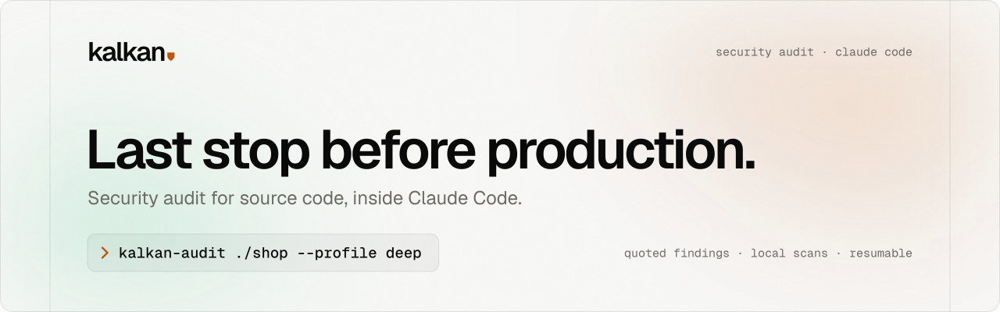

<p align="center">
  <picture>
    <source media="(prefers-color-scheme: dark)" srcset="docs/brand/kalkan-banner-dark.svg">
    
  </picture>
</p>

<p align="center">
  <a href="#hızlı-başlangıç">Hızlı başlangıç</a> ·
  <a href="#nasıl-çalışır">Nasıl çalışır</a> ·
  <a href="#güvenlik-modeli">Güvenlik modeli</a> ·
  <a href="docs/BRAND.md">Marka</a> ·
  <a href="README.md">English</a>
</p>

kalkan, Claude Code içinde çalışan bir kaynak kod güvenlik denetim aracıdır. Tek bir istek, bir klasör veya git reposu üzerinde uzun ve çok aşamalı bir denetim başlatır. Denetimin bütün durumu diskte durur. Bu yüzden denetim, kullanım limiti sıfırlanınca kaldığı yerden devam eder. Rapor varsayılan olarak İngilizce. `--lang tr` ile rapor Türkçe olur ve istersen İngilizce sürümü de üretilir. Biçimler: Markdown, HTML, JSON ve SARIF 2.1.0.

> **Durum (sürüm 1.16.0):** Motor, sabit sürümlü bütün tarayıcılar (Go dahil), tamamen yerel SCA, taze göz son incelemeli ajan orkestrasyonu, gözetimsiz çalışma, Claude Code eklentisi ve Codex desteği çalışıyor. PoC doğrulama sandbox'ı (ADR-0006), bir Docker motoru yanıt verdiğinde birim düzeyi kontrolleri ağsız bir konteynerde çalıştırır. Docker yoksa bulgular, motorun doğruladığı statik kanıta ve son incelemeye dayanır. Güvenlik garantileri: [docs/SECURITY.md](docs/SECURITY.md).

## Hızlı başlangıç

### Kurulum (1 komut)

Gerekenler: git, Python 3.11 veya üstü ve oturum açılmış Claude Code. Sonra tek satırı çalıştır:

Linux, macOS, Git Bash:

```sh
curl -fsSL https://raw.githubusercontent.com/dtechcloud/kalkan/main/scripts/install.sh | sh
```

Windows (PowerShell):

```powershell
& ([scriptblock]::Create((irm https://raw.githubusercontent.com/dtechcloud/kalkan/main/scripts/install.ps1)))
```

Kurulum betiği gereksinimleri kontrol eder. kalkan marketplace'ini ekler ve kalkan eklentisini kendi kullanıcın için kurar (user scope). Sonra sabit sürümlü tarayıcıları ve yerel güvenlik açığı veritabanlarını kurar. En son `kalkan doctor` çalıştırır. İlk kurulum 5-15 dakika sürer. kalkan'ı güncellemek için aynı satırı yeniden çalıştır. Her hata mesajı düzeltme komutunu verir. Komutları önce görmek için `--dry-run` ekle (`... | sh -s -- --dry-run`). PowerShell'de son parantezden sonra `-DryRun` yaz.

Tek satır olmadan: önce `git clone https://github.com/dtechcloud/kalkan.git` çalıştır. Sonra `sh kalkan/scripts/install.sh` çalıştır (Windows: `powershell -ExecutionPolicy Bypass -File kalkan\scripts\install.ps1`).

### Denetim (1 komut)

Linux, macOS, Git Bash:

```sh
sh ~/.claude/plugins/data/kalkan-kalkan/bin/kalkan-audit <klasör veya git URL>
```

Windows (PowerShell):

```powershell
& "$HOME\.claude\plugins\data\kalkan-kalkan\bin\kalkan-audit.cmd" <klasör veya git URL>
```

Aşağıda `kalkan-audit` bu komutun yerine geçer. Kurulum betiği komutu senin yolunla yazar.

| Amaç | Komut |
|---|---|
| Yerel bir klasörü denetle (`standard` profil) | `kalkan-audit C:/code/shop` |
| Bir GitHub reposunu denetle | `kalkan-audit https://github.com/org/repo` |
| İlk bakış veya derin denetim | `kalkan-audit C:/code/shop --profile fast` veya `--profile deep` |
| Claude Code olmadan yalnızca tarayıcılar, SCA ve rapor (CI, hızlı bakış) | `kalkan-audit C:/code/shop --tools-only` |
| Sonunda yönetici özetini aç | `kalkan-audit C:/code/shop --open` |
| Eksik araçları ve veritabanlarını sormadan kur | `kalkan-audit C:/code/shop --yes` |
| Durmuş bir denetime devam et | `kalkan-audit devam <run-id>` |

Aynı anda iki denetim: her denetimi kendi terminalinde başlat. Her denetim kendi run ID'sine bağlanır. Yan denetime `--no-latest` ekle. Böylece yalnızca `devam` yine ana denetime devam eder:

```sh
kalkan-audit C:/code/shop --profile deep
kalkan-audit C:/code/tool --profile fast --no-latest
```

Komut şu adımları yapar:

1. Kurulumu kontrol eder. Eksik araç veya veritabanını yalnızca `--yes` ile ya da sen `y` dersen kurar. Onay yoksa düzeltme komutunu yazar ve çıkış kodu 5 ile durur.
2. Hedefi kopyalar. Tarayıcıları ve SCA'yı çalıştırır. Her adım için bir satır yazar.
3. Headless Claude Code turlarını başlatır. Turlar hedefi haritalar, bulgu arar, bulguları doğrular ve inceler. Kullanım limiti dolarsa turlar sıfırlanmayı bekler ve sıfırlanma saatini yazar. `--tools-only` bu adımı atlar. O zaman rapor her sonucu doğrulanmamış araç sonucu olarak işaretler.
4. Kısa bir özet yazar: genel risk, ciddiyete göre bulgular ve en önemli 3 bulgu. Sonra `~/kalkan-runs/<run-id>/report/` klasöründeki dosyaları listeler: `EXECUTIVE.html` (önce bunu aç), `REPORT.html`, `REPORT.md`, `findings.sarif`, `findings.json`, `summary.json` ve SBOM.

Çıkış kodları: 0 bitti, 1 eksik kaldı veya durdu (mesaj devam komutunu verir), 5 kurulum gerekli (mesaj düzeltmeyi verir).

Bir kalkan checkout'unda aynı komut `kalkan audit <hedef>` olur. Önce aşağıdaki bootstrap'i çalıştır ve venv'i etkinleştir. Venv etkin değilse Windows'ta `.venv\Scripts\kalkan.exe audit <hedef>`, Linux ve macOS'ta `.venv/bin/kalkan audit <hedef>` yaz. Konteyner imajı yerel kurulum olmadan `kalkan audit /src --tools-only` çalıştırır ([docker/README.md](docker/README.md)).

## Gereksinimler

- Python 3.11 veya üstü ve git (Windows'ta Git for Windows).
- Claude Code CLI, sürüm 2.1 veya üstü. Bir Claude planıyla oturumu açık olmalı ya da bir API anahtarıyla ayarlanmış olmalı ([API anahtarıyla çalıştırma](#api-anahtarıyla-çalıştırma)). `--tools-only` denetimi Claude Code istemez.
- İlk kurulum için internet erişimi. Bootstrap betiği sabit sürümlü araçları indirir. Go araç zinciri de bunlara dahildir. Betik yerel güvenlik açığı veritabanlarını da indirir (`kalkan sca update-db`): yaklaşık 290 MB OSV veritabanı ve Grype veritabanı (2026-10-29'da diskte 3,67 GB). Denetimin kendisi, Claude oturumun dışında ağı kullanmaz.
- İsteğe bağlı: Docker (PoC doğrulama sandbox'ı ve konteyner imajı için).
- Windows 11, Linux veya macOS. Sürüm 1.5.0'dan beri testler yalnızca Windows 11'de çalıştı.

Go kurman gerekmez. kalkan, Go 1.26.9'u SHA-256 kontrolüyle `.tools/go/` klasörüne kurar. gosec ve govulncheck bu Go ile çalışır. poutine bu Go ile derlenir. Sistemdeki Go 1.26 veya üstü yalnızca bu kopya eksikse kullanılır.

## Claude Code oturumunda denetim (checkout)

1. Repoyu klonla. Repo klasöründe bir terminal aç.
2. Bootstrap betiğini çalıştır. Betik `.venv` klasörünü oluşturur. Ardından kalkan'ı, sabit sürümlü tarayıcıları ve Go araç zincirini SHA-256 kontrolüyle kurar. Sonra yerel güvenlik açığı veritabanlarını indirir. Son olarak `kalkan doctor` çalıştırır. Bir araç eksik veya bozuksa betik hatayla durur.
   - Windows: `powershell -ExecutionPolicy Bypass -File scripts\bootstrap.ps1`
   - Linux, macOS: `sh scripts/bootstrap.sh`
3. Repo klasöründe Claude Code'u başlat (`claude`) ve trust sorusunu onayla. Claude Code, trust edilmemiş bir klasörde projenin izin kurallarını yok sayar. O zaman denetim ajanları sonuçlarını yazamaz.
4. `/kalkan <yol veya git URL> standard` yaz.
5. Kullanım limiti denetimi durdurursa, limit sıfırlanınca `/kalkan devam <run-id>` yaz. Başlangıç mesajı run ID'yi verir. Yalnızca `/kalkan devam` en yeni run'a devam eder.

Aynı anda birden fazla denetim çalıştırabilirsin. Her denetim için ayrı bir oturum veya terminal aç. Her orkestratör kendi run'ını `--run <run-id>` ile adlandırır ([docs/PLUGIN.md](docs/PLUGIN.md#parallel-audits)).

Rapor `runs/<run-id>/report/` klasörüne yazılır: `REPORT.md`, `REPORT.html`, `EXECUTIVE.html`, `findings.sarif`, `findings.json` ve `summary.json`. `EXECUTIVE.html` yöneticiler için tek sayfalık bir özettir. Genel risk seviyesini, `REPORT.html` bağlantılı en önemli 10 bulguyu, sınıfları, bileşenleri, bağımlılıkları, araç sonuçlarını, kapsamı ve öncelikli aksiyonları gösterir. Rapor varsayılan olarak İngilizce. Türkçe rapor için başlatma komutuna `--lang tr` ekle (`/kalkan <hedef> --lang tr` veya `kalkan-audit <hedef> --lang tr`). Claude Code oturumundaki Türkçe bir denetim, sonda İngilizce sürümü de isteyip istemediğini sorar (`REPORT.en.md`, `REPORT.en.html`, `EXECUTIVE.en.html`).

## Claude Code eklentisi olarak kurulum

Eklenti kalkan'ı her klasörden çalıştırır: CLI'da ve VS Code eklentisinde. Repoyu klonlaman gerekmez. [Hızlı başlangıç](#kurulum-1-komut) bölümündeki kurulum betiği bu adımları senin için yapar. Elle yapmak istersen:

```sh
claude plugin marketplace add dtechcloud/kalkan
claude plugin install kalkan@kalkan --scope user
```

Oturum içinden: `/plugin install kalkan --marketplace dtechcloud/kalkan` (Claude Code 2.1.275 veya sonrası). VS Code'da: `/plugins` yaz, `dtechcloud/kalkan` marketplace'ini ekle, `kalkan` eklentisini kur. Sonra herhangi bir klasörde `/kalkan https://github.com/org/repo deep` yaz. İlk çalıştırma motoru ve tarayıcıları kurar (5-15 dakika). Raporlar `~/kalkan-runs/` klasörüne yazılır. Ayrıntılar: [docs/PLUGIN.md](docs/PLUGIN.md).

Terminalden: [hızlı başlangıçtaki](#denetim-1-komut) `kalkan-audit` kurulumu kontrol eder, denetimi çalıştırır ve özeti yazar. `kalkan-unattended` bir run'ın yalnızca ajan turlarını çalıştırır, örneğin `sh ~/.claude/plugins/data/kalkan-kalkan/bin/kalkan-unattended <hedef>` ([docs/PLUGIN.md](docs/PLUGIN.md#unattended-runs)).

## Profiller

| Profil | Ajan görevi bütçesi | Critic turu | Ne zaman |
|---|---|---|---|
| `fast` | 40 | 1 | İlk bakış, küçük repolar |
| `standard` | 150 | 2 | Varsayılan |
| `deep` | 400 | 3 | Büyük veya kritik sistemler |

Sürüm 1.6.0'dan önceki adlar (`hizli`, `quick`, `standart`, `derin`) hâlâ çalışır. Eski bir sürümün başlattığı denetim de kaldığı yerden devam eder.

## Gözetimsiz çalışma

Tek komutluk yol `kalkan audit` komutudur ([hızlı başlangıç](#denetim-1-komut)). Kurulumu kontrol eder, tarayıcıları kendisi çalıştırır, sonra run'ı bu turlara verir. `kalkan unattended`, Claude Code'u headless (`claude -p`) olarak tur tur çalıştırır. Kullanım limitinin sıfırlanmasını bekler. Denetim bitince durur.

- Windows: `scripts\run-unattended.ps1 <yol> --profile standard`
- Linux, macOS: `scripts/run-unattended.sh <yol> --profile standard`
- Devam etmek için: `kalkan unattended devam <run-id>` (durma mesajı bu komutu verir). Yalnızca `kalkan unattended devam` en yeni run'a devam eder. Codex için `--host codex` kullan ([docs/CODEX.md](docs/CODEX.md)).

## API anahtarıyla çalıştırma

kalkan bir Claude planı istemez. Ajan turları Claude Code içinde çalışır ve Claude Code bir API hesabıyla da çalışır. Bir sağlayıcının değişkenlerini `kalkan-audit` ortamında tanımla:

| Sağlayıcı | Değişkenler |
|---|---|
| Claude API | `ANTHROPIC_API_KEY` |
| Microsoft Foundry | `CLAUDE_CODE_USE_FOUNDRY=1`, `ANTHROPIC_FOUNDRY_RESOURCE` (veya `ANTHROPIC_FOUNDRY_BASE_URL`), `ANTHROPIC_FOUNDRY_API_KEY` (yoksa Entra ID: `az login`) |
| Amazon Bedrock | `CLAUDE_CODE_USE_BEDROCK=1`, `AWS_REGION`, AWS kimlik bilgileri |
| Google Vertex | `CLAUDE_CODE_USE_VERTEX=1`, `CLOUD_ML_REGION`, `ANTHROPIC_VERTEX_PROJECT_ID` |

Foundry, Bedrock ve Vertex'te ayrıca `ANTHROPIC_DEFAULT_OPUS_MODEL`, `ANTHROPIC_DEFAULT_SONNET_MODEL` ve `ANTHROPIC_DEFAULT_HAIKU_MODEL` değişkenlerini tanımla (Foundry'de deployment adları).

1. `kalkan doctor` çalıştır. `claude` satırı API modunu (örneğin `API: foundry`) veya eksik değişkeni yazar.
2. Denetimi bir sınırla başlat: `kalkan-audit <hedef> --profile fast --max-usd 100`. Kayıtlı maliyet sınıra ulaşınca yeni tur başlamaz. Her tur kalan tutarı `--max-budget-usd` olarak alır.
3. Maliyeti `EXECUTIVE.html` dosyasında ("API hesabından ödendi") veya çalıştırma klasöründeki `usage.jsonl` dosyasında oku. Bu dosya her turun giriş yöntemini, modelini, maliyetini ve token sayısını tutar. Tutar, Claude Code'un liste fiyatıyla yaptığı tahmindir. Kesin tutar sağlayıcının faturasındadır.

kalkan bir anahtarın yalnızca değişken adını kaydeder, değerini kaydetmez. Hız limiti düşükse: `kalkan run set --max-parallel 2`. Site belgesi: `site/docs.html#api`.

## Disk kullanımı ve temizlik

- `kalkan clean`, kalkan'ın makinede tuttuklarını boyutlarıyla gösterir: motor, araçlar, güvenlik açığı veritabanları, önbellekler ve run'lar. 2026-10-29'da Windows'ta ölçüldü (eklenti): araçlar 1,53 GB, veritabanları 3,67 GB. `kalkan doctor` aynı boyutları `footprint` satırında gösterir.
- `kalkan run clean <run-id>`, biten bir run'ın hedef kopyasını, geçmiş kopyasını ve iş klasörlerini siler. Raporu bırakır. `--dry-run` önce boyutları gösterir.
- `kalkan clean --runs`, `--caches`, `--databases`, `--tools` veya `--all` bir bölümü siler. Önce silinecekleri listeler ve onay ister (`--dry-run` yalnızca listeler, `-y` soruyu atlar). Yalnızca kalkan'ın kendi klasörlerini siler. Bir bağlantıyı (symlink, junction) bağlantı olarak siler; bağlantının gösterdiği klasör yerinde kalır.
- `kalkan sca update-db`, 24 saatten yeni bir veritabanını yeniden indirmez (`--force` indirir). Kurulum betikleri 7 günden yeni veritabanlarını tutar. Bir hafta içindeki yeni bir kurulum hiçbir veritabanı indirmez.
- Hiçbir tarayıcı kalkan klasörlerinin dışına yazmaz. Hangisinin nereye yazdığını [docs/SECURITY.md](docs/SECURITY.md#what-kalkan-writes-where) listeler. Eklentiyi kaldırmak için önce `kalkan clean --all`, sonra `claude plugin uninstall kalkan@kalkan` çalıştır ([docs/PLUGIN.md](docs/PLUGIN.md#update-and-uninstall)).

## Nasıl çalışır

1. **Motor.** `kalkan`, çalışma zamanında hiçbir bağımlılığı olmayan deterministik bir Python CLI'ıdır. Hiçbir zaman dil modeli çağırmaz. Hedefi kopyalar, tarayıcıları ve SCA'yı çalıştırır, kapsamı planlar, ajanlara görev dağıtır, her ajan sonucunu kontrol eder ve kararı hesaplar.
2. **Ajanlar.** `/kalkan` skill'i `kalkan run next` döngüsünü çalıştırır ve salt okunur alt ajanlar başlatır: recon, hunter, verifier, reviewer, consolidator, polisher, critic, sca-reach, poc-builder ve translator. Her alt ajan tek bir prompt dosyası okur ve tek bir JSON sonucu yazar.
3. **Karar.** Verifier her aday için üç soruyu yanıtlar: saldırgan kontrolü, yetki sınırı ve eksik koruma. Her yanıtın arkasındaki kaynak satırını alıntılar. Motor her alıntıyı dosyada ±2 satır içinde arar. Doğrulanmış tek bir çürütme adayı reddeder. Üç kanıtlanmış yanıt onu doğrular. Geri kalan her durum `needs_validation` olur.
4. **Son inceleme.** `standard` ve `deep` profillerinde yeni bir reviewer, doğrulanan ve doğrulama bekleyen her son kaydı verifier'ın gerekçesini görmeden kaynakla karşılaştırır. Motor `verified`, `downgrade` veya `reject` kararını uygular. Bir kaydı hiçbir zaman güçlendirmez.
5. **Aşamalar:** prep → deterministik tarayıcılar → SCA → recon → plan → hunt ⇄ critic → validate (verify, son inceleme, sonra birleştirme: consolidator aynı kök nedenli kayıtları gruplar, motor onları tek bir birincil bulgunun altında listeler. Türkçe bir çalıştırmada sonra polisher eksik Türkçe harfleri geri koyar. Motor bir alanı yalnızca başka hiçbir şey değişmediyse kabul eder) → poc → merge → report.

## Tarayıcılar ve bilgi

| Alan | Araçlar |
|---|---|
| Kod kalıpları | Opengrep 1.30.1 ve kalkan'ın kendi 106 kuralı, Opengrep kural paketleri (GitLab sast-rules, Trail of Bits, 0xdea, elttam, njsscan, mobsfscan, Atlassian, Minded Security, Aikido ve semgrep-codeql'den seçilmiş 733 kural; `KALKAN_RULE_PACKS=osi` AGPL paketini kapatır), Bandit 1.9.4, gosec 2.29.0, ShellCheck 0.11.0 (kabuk betikleri), flawfinder 2.0.20 (C ve C++), 204 matcher (deepsec'ten port edilen 198 ve kalkan'ın kendi 6 kuralı) |
| Sırlar | Gitleaks 8.30.1 ve Kingfisher 2.11.1 (çalışma ağacı ve git geçmişi, değerler gizlenir, doğrulama yapılmaz) |
| IaC ve konteyner | Trivy 0.75.0, Checkov 3.3.22 (ağ gerektirmeyen bütün çerçeveler ve helm 4.3.0'ın ağsız çizdiği Helm chart'ları), Hadolint 2.15.1, gixy 0.2.55 (nginx) |
| API tanımları | vacuum 0.33.0 (OpenAPI 3 ve Swagger 2.0, OWASP API kuralları) |
| CI/CD ve tedarik zinciri | zizmor 1.30.1 ve actionlint 1.7.12 (GitHub Actions), poutine 1.1.6 (GitHub Actions, GitLab CI, Azure Pipelines, Tekton), OpenSSF Scorecard 5.5.0 (yerel mod: depo güvenlik duruşu) |
| SCA | Syft 1.54.0, OSV-Scanner 2.6.0, Grype 0.119.0, govulncheck 1.8.0, erişilebilirlik (reachability) ajanları |
| Bilgi | 42 zafiyet sınıfı paketi, 10 alan paketi, 9 dil paketi ([knowledge/](knowledge/)) |

OWASP Juice Shop, DVWA ve test fixture'ı üzerinde deterministik kısmın benchmark sonuçları: [benchmarks/results/SUMMARY.md](benchmarks/results/SUMMARY.md).

## Güvenlik modeli

- Denetim, hedefin `runs/<run-id>/target/` altındaki kopyası üzerinde çalışır. Hedefin ajan talimat dosyaları `.kalkan-neutralized` ekiyle yeniden adlandırılır. Örnekler: `CLAUDE.md`, `AGENTS.md`, `.claude/`, `.cursorrules`.
- Alt ajanların yalnızca Read, Grep, Glob ve Write araçları var. Shell ve web erişimleri yok. Her prompt, hedefin talimat değil veri olduğunu söyler.
- Tarayıcılar, hedefin kendi bastırma işaretlerini yok sayar. Örnekler: `# nosec`, `gitleaks:allow`, `checkov:skip` ([ADR-0003](docs/decisions/ADR-0003-target-suppressions.md)).
- Tarayıcılar hedef kodu hiçbir zaman çalıştırmaz. PoC doğrulama sandbox'ı kontrollerini yalnızca hedefin kopyası üzerinde, ağsız bir konteynerde çalıştırır (ADR-0006).

## Güvenlik güvenceleri

Ayrıntılar ve testler [docs/SECURITY.md](docs/SECURITY.md) dosyasında (İngilizce).

**1. kalkan denetlenen projeyi hiçbir zaman değiştirmez.**

- `run init` hedefi `runs/<run-id>/target/` klasörüne kopyalar. Orijinal klasörü yalnızca okur.
- Hedef bir git çalışma ağacıysa kalkan geçmişin özel bir kopyasını `runs/<run-id>/source/` klasörüne alır. Komut: `git clone --mirror --no-local`. Kopyanın orijinale bağlantısı kalmaz.
- `gitleaks-history` ve `kingfisher-history` yalnızca bu kopyayı tarar. Hiçbir tarayıcı orijinal yolu almaz.
- Runs klasörü hedefin içindeyse `run init` reddeder. `KALKAN_RUNS_DIR` değişkenine hedefin dışında bir klasör ver.
- Test: tuzaklı bir repo kuruldu (fsmonitor, textconv, filter, hook). Her dosyanın hash'i, boyutu ve zamanı `run init`, `scan all` ve `sca match` öncesinde ve sonrasında aynı kaldı. Hiçbir tuzak çalışmadı.

**2. Ajanlar yalnızca kendi sonuç dosyalarına yazar.**

- Checkout: `.claude/settings.json` yalnızca motor komutlarına ve sonuç dosyalarına izin verir. Web araçlarını ve ağ komutlarını engeller. `runs/` dışındaki düzenlemeler için deny kuralı yok, çünkü deny kuralı geliştirmeyi de engellerdi. Ajanların araç listesi zaten yalnızca Read, Grep, Glob ve Write.
- Eklenti: PreToolUse hook'u (`kalkan.plugin_hook`) bir kalkan alt ajanının her çağrısına `allow` veya `deny` verir. Okuma yalnızca kendi run'ının `target/` ve `tasks/` klasörlerinde serbest. Tek istisna: Claude Code'un `tool-results` klasörüne kaydettiği, aynı oturumun araç çıktıları (yalnızca Read). Yazma yalnızca kendi görevinin `result.json` dosyasına serbest. Bash, Edit, WebFetch, WebSearch ve MCP araçları reddedilir.
- Bir oturum kalkan denetimi yürütürken hook o oturumun ağ araçlarını da reddeder. Diğer oturumlara dokunmaz.

**3. Senin Claude oturumunun Anthropic trafiği dışında hiçbir veri makineden çıkmaz.**

- Varsayılan yerel mod: hiçbir tarayıcı ve SCA aracı ağı kullanmaz. OSV-Scanner `--offline` ile çalışır. Grype indirdiği veritabanını güncelleme yapmadan kullanır.
- Kingfisher bulduğu sırları sağlayıcı servisine sormaz (`--no-validate`) ve güncelleme kontrolü yapmaz (`--no-update-check`). Bu iki bayrak `--online` ile de kapalı kalır. Sır değerleri kalkan dosyalarına yazılmaz.
- Checkov, helm ve kustomize çerçevelerini çalıştırmaz. Bu çerçeveler uzak chart'ları ve tabanları indirirdi. Checkov boş bir ev klasörüyle çalışır, bu yüzden `~/.bridgecrew/credentials` dosyasındaki bir API anahtarını göremez.
- kalkan Helm chart'larını kendisi çizer. `helm template` bağımlılık indirmez ve `values.schema.json` doğrulamasını atlar, çünkü bu doğrulama uzak şema dosyalarını indirirdi. Aynı nedenle Trivy yerel modda chart çizmez.
- vacuum uzak `$ref` adreslerini indirmez (`--remote=false`). Bir `$ref` hedefin dışındaki bir dosyayı gösteriyorsa kalkan o belgeyi vacuum'a vermez. vacuum o dosyayı makineden okurdu.
- `kalkan sca update-db` veritabanlarını bir kez indirir: OSV, Grype, govulncheck'in Go veritabanı ve projeye gömülü JavaScript kütüphaneleri için RetireJS deposu. Yalnızca ekosistem adlarını ve arşiv isteklerini gönderir. Bootstrap ve eklenti kurulumu bu komutu çalıştırır.
- Veritabanı eksikse `sca match` çevrimiçi sorgu yapmaz. Raporda bir veritabanı boşluğu gösterir.
- `--online` bayrağı isteğe bağlıdır. Bu bayrak paket adlarını çevrimiçi servislere gönderir.
- Test: araçlar, bağlantıları sayan yerel bir tuzak proxy ile çalıştı. Yerel modda sıfır bağlantı oldu.

**Makineden ne çıkar:** Claude oturumunun Anthropic trafiği (ajanların okuduğu hedef kodu dahil), araç ve veritabanı indirmeleri (kurulumda), git URL hedefinin klonu, `kalkan sandbox pull` ile indirilen sandbox temel imajları ve `--online` seçeneği.

**Kalan riskler:** Eklenti modunda ana oturum senin izin moduna uyar. `bypassPermissions` ile çalışırsan diğer çağrıların izin soruları kalkar. Hook'un `deny` kararı bu modda da geçerli (Claude Code 2.1.301 ile ölçüldü). Ağ komutu listesi bir sezgiseldir. Codex modunda alt ajanın shell'i var. Tam liste: [docs/SECURITY.md](docs/SECURITY.md#residual-risks).

## Sorun giderme

- `kalkan doctor` sabit sürümlü her aracı kontrol eder. Go araç zinciri de bunlara dahildir. Eksik veya bozuk bir araç `fail` verir. O satır düzeltme komutunu yazar, örneğin `kalkan tools install go` veya `kalkan tools install --force gosec`. Docker motoru, git veya Claude CLI eksikse sonuç `warn` olur. Claude CLI'da oturum açık değilse sonuç yine `warn` olur (düzeltme: `claude auth login`). Doctor klasörün trust durumunu da gösterir. Manifestteki her araç kendi satırını alır. Bu yüzden yeni bir tarayıcı için doctor değişmez.
- `kalkan tools install --all` her şeyi yeniden kurar. Sağlam araçlara dokunmaz. `kalkan tools verify` kurulu her dosyanın hash'ini yeniden hesaplar. Go'nun 15045 dosyası için bu, virüs tarayıcılı bir Windows makinesinde 8 dakika sürdü. `kalkan tools verify --quick`, doctor'ın kullandığı hızlı kontroldür.
- `go.mod` dosyası 1.26.9'dan yeni bir Go isteyen bir hedef (örneğin `go 1.27`): kalkan Go'yu `GOTOOLCHAIN=local` ile çalıştırır. Bu yüzden gosec ve govulncheck o modülde başarısız olur. Durum dosyası nedenini yazar.
- Windows'ta Opengrep, yolu 260 veya daha fazla karakter olan dosyaları atlar. Rapor uzun yol uyarısı verirse `KALKAN_RUNS_DIR` değişkenine kısa bir klasör ver (örneğin `C:\kr`). Sonra yeni bir denetim başlat.
- Windows'ta poutine 1.1.6 ve Scorecard 5.5.0, GitHub Actions iş akışlarını görmez. Yerel modları yolları `/` ile karşılaştırır. Bu iş akışlarını orada zizmor ve actionlint kontrol eder. `scans/poutine.status.json` ve `scans/scorecard.status.json` atlanan dosyaları `platform_gap` altında listeler. poutine, Windows'ta GitLab CI ve Azure Pipelines dosyalarını okumaya devam eder.
- Kilit dosyası (lockfile) olmayan bir hedefte kalkan sabit sürümleri (pin) kontrol eder. Sürüm aralıkları raporda tarama boşluğu olarak listelenir.
- Raporda "chart dependencies missing from charts/" (helm-checkov) tarama boşluğu varsa: yerel mod chart indirmez. Bağımlılıkları projende chart'ın `charts/` klasörüne koy (`helm dependency build`). kalkan `helm dependency update` çalıştırmaz.
- vacuum bir OpenAPI belgesini `references: ...` nedeniyle atladıysa: belgedeki bir `$ref` hedefin dışına çıkıyor ya da kalkan'ın kontrol edemediği bir biçimde. vacuum o dosyayı makineden okurdu. Bu yüzden kalkan belgeyi vacuum'a vermez.
- govulncheck `no local Go vulnerability database` nedeniyle atlandıysa `kalkan sca update-db` komutunu çalıştır. Komut `https://vuln.go.dev/vulndb.zip` arşivini indirir. İndirme başarısız olursa veritabanını OSV Go kayıtlarından kurar (`--go-source osv` bu kurulumu zorlar). `kalkan doctor` kaynağı ve tarihini gösterir.
- Raporda "Go paketleri hatayla yüklendi" (gosec) veya "Go paketleri yüklenemedi" (govulncheck) tarama boşluğu varsa: içe aktarılan bir paketin modülü yerel modül önbelleğinde yok. Yerel mod modül indirmez. Hedefe bir `vendor/` klasörü ekle (`go mod vendor`). Ya da `kalkan scan gosec --online` ve `kalkan sca reach --online` çalıştır. Bu iki komut modül yollarını Go proxy'ye gönderir.

## Diğer belgeler

- Mimari ve sözleşmeler: [docs/ARCHITECTURE.md](docs/ARCHITECTURE.md), [docs/ENGINE-SPEC.md](docs/ENGINE-SPEC.md), [docs/PHASES.md](docs/PHASES.md).
- [docker/README.md](docker/README.md): bütün araçları içeren konteyner imajı.
- [docs/PLUGIN.md](docs/PLUGIN.md): Claude Code eklentisi (kurulum, veri klasörleri, izinler).
- [docs/SECURITY.md](docs/SECURITY.md): güvenlik güvenceleri, makineden çıkan veriler, kalan riskler.
- [docs/CODEX.md](docs/CODEX.md): OpenAI Codex CLI desteği.
- [docs/DEVELOPMENT.md](docs/DEVELOPMENT.md): geliştirme kuralları ve testler.
- [docs/BRAND.md](docs/BRAND.md): isim, slogan, logo, renkler ve yazı tipi.

## Teşekkürler

kalkan aşağıdaki projelerin emeği üzerine kurulu. Yazarlarına ve katkı verenlerine teşekkür ederiz. Kopyalanan dosyalar, sabitlenen commit'ler ve lisanslar [THIRD_PARTY.md](THIRD_PARTY.md) ve [NOTICE](NOTICE) dosyalarında. kalkan ayrıca 21 açık kaynak tarayıcı çalıştırır. Her birinin kendi lisansı var ([THIRD_PARTY.md](THIRD_PARTY.md#external-tools-installed-at-setup-time-not-part-of-this-repository)).

| Proje | Yazar | kalkan'ın kullandığı |
|---|---|---|
| [security-audit-skill](https://github.com/cloudflare/security-audit-skill) | Cloudflare | Faz modeli, kapsam defteri, bulgu şeması, doğrulayıcılar, alan paketleri |
| [sast-skills](https://github.com/utkusen/sast-skills) | Utku Sen | Zafiyet sınıfı bilgisi, gruplama yöntemi, rapor yapısı |
| [deepsec](https://github.com/vercel-labs/deepsec) | Vercel | 198 regex matcher, regex güvenlik kontrolleri, avcı ipuçları |
| [codecrucible](https://github.com/block/codecrucible) | Block | Alıntı doğrulayıcı, karar kuralları, bulgu kimliği, CWE aileleri, dil paketleri |
| [open-code-review](https://github.com/alibaba/open-code-review) | Alibaba | Dil kurallarının güvenlik bölümleri, temkinli inceleme filtresi |
| [retire.js](https://github.com/RetireJS/retire.js) | Erlend Oftedal | Projeye kopyalanmış JavaScript kütüphanelerinin kontrolü ve verisi |
| [GitLab sast-rules](https://gitlab.com/gitlab-org/security-products/sast-rules) | GitLab | Opengrep kuralları |
| [semgrep-rules](https://github.com/0xdea/semgrep-rules) | 0xdea (raptor) | C ve C++ için Opengrep kuralları |
| [semgrep-rules](https://github.com/trailofbits/semgrep-rules) | Trail of Bits | Opengrep kuralları |
| [semgrep-rules](https://github.com/elttam/semgrep-rules) | elttam | Opengrep kuralları (Java, Go, C#, Python, PHP) |
| [njsscan](https://github.com/ajinabraham/njsscan), [mobsfscan](https://github.com/MobSF/mobsfscan) | Ajin Abraham ve katkı verenler | Node.js, Android, Kotlin ve Swift için Opengrep kuralları |
| [atlassian-sast-ruleset](https://github.com/atlassian-labs/atlassian-sast-ruleset) | Atlassian | Java şablon motorları ve deserialization için Opengrep kuralları |
| [semgrep-rules-android-security](https://github.com/mindedsecurity/semgrep-rules-android-security) | IMQ Minded Security | Android için Opengrep kuralları (OWASP MASTG) |
| [opengrep-rules](https://github.com/AikidoSec/opengrep-rules) | Aikido Security | GitHub Actions ve npm için Opengrep kuralları |
| [semgrep-codeql](https://github.com/andrew/semgrep-codeql) | Andrew Nesbitt (GitHub'ın CodeQL sorgularından) | CodeQL'den dönüştürülmüş Opengrep kuralları |

## Sorumlu kullanım

Yalnız sana ait olan veya test etmek için yazılı izin aldığın kodu denetle. PoC sandbox'ı kodu yalnız denetim kopyasından, ağsız bir konteynerde çalıştırır.

## Katkı ve güvenlik bildirimi

- Katkı: [CONTRIBUTING.md](CONTRIBUTING.md).
- kalkan'da bir açık bulursan herkese açık issue açma. [SECURITY.md](.github/SECURITY.md) dosyasındaki yolu izle.
- İletişim: kalkan@dtechcloud.com

## Lisans

kalkan'ın kodu MIT lisanslı ([LICENSE](LICENSE)). `third_party/` altındaki içerik, `rules/opengrep-packs/` içindeki kural paketleri ve farklı SPDX başlığı taşıyan dosyalar kendi upstream lisanslarını korur: MIT, Apache-2.0, LGPL-2.1, LGPL-3.0, GPL-3.0 (Minded Security kuralları) ve AGPL-3.0 (Trail of Bits kuralları). `KALKAN_RULE_PACKS=osi` AGPL paketini kapatır. Ayrıntı: [NOTICE](NOTICE), [THIRD_PARTY.md](THIRD_PARTY.md).
